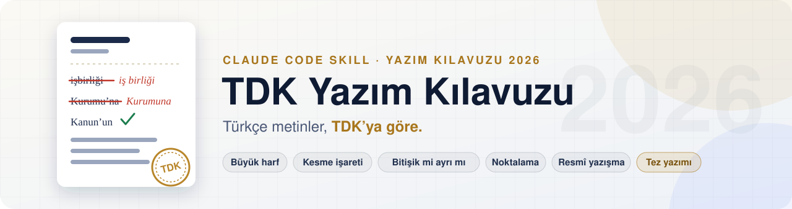
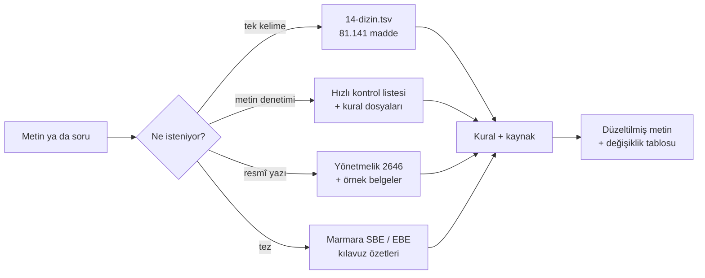

<div align="center">

<picture>
  <source media="(prefers-color-scheme: dark)" srcset="assets/banner-dark.svg">
  <source media="(prefers-color-scheme: light)" srcset="assets/banner-light.svg">
  
</picture>

<br/>

[](https://github.com/hasanimer/yazim-kilavuzu-skill/actions/workflows/validate.yml)


[](LICENSE)

**[Kurulum](#-kurulum)** · **[Örnekler](#-örnekler)** · **[Ne sorabilirsiniz?](#-ne-sorabilirsiniz)** · **[Kaynaklar](#-kaynaklar)** · **[Neden metinler depoda yok?](#-neden-tdk-metinleri-depoda-yok)**

</div>

<br/>

Türkçe metinleri **TDK Yazım Kılavuzu'nun 2026 baskısına** göre yazan ve düzelten bir Claude Code skill'i:
- **Yazım denetimi:** büyük harf, kesme işareti, bitişik/ayrı yazım, *de/da*, *ki*, *mi*, sayılar, kısaltmalar, noktalama ve düzeltme işareti.
- **Kelime sorgusu:** bir kelimenin doğru yazılışını TDK'nın 81.141 maddelik resmî dizininde arar; tahmin etmez.
- **Resmî yazışma:** kamu kurumlarına yazılan yazılarda *Resmî Yazışmalarda Uygulanacak Usul ve Esaslar Hakkında Yönetmelik* kuralları.
- **Tez yazımı:** Marmara Üniversitesi Sosyal Bilimler ve Eğitim Bilimleri enstitülerinin tez yazım kılavuzları.

Her düzeltme **kuralın adı ve kaynağıyla** gelir. Alıntılar, mevzuat ve karar metinlerinden yapılan aynen aktarmalar ve özel adlar değiştirilmez.

<table>
<tr>
<td align="center" width="25%"><h3>2026</h3><sub>TDK Yazım Kılavuzu baskısı,<br/>13 bölümün tam metni</sub></td>
<td align="center" width="25%"><h3>81.141</h3><sub>madde: resmî Yazım Kılavuzu Dizini<br/>(ek alınca aldığı biçimle)</sub></td>
<td align="center" width="25%"><h3>1.089</h3><sub>TDK Kısaltmalar Dizini satırı<br/>+ Dil Derneği karşılaştırması</sub></td>
<td align="center" width="25%"><h3>3 modül</h3><sub>Resmî Yazışma Yönetmeliği ·<br/>Marmara SBE · Marmara EBE</sub></td>
</tr>
</table>

## ✦ Ne yapar?

<table>
<tr>
<td width="50%" valign="top">

### 01 · Metin denetimi
Dilekçe, sözleşme, rapor ya da makaleyi okur. Önce düzeltilmiş metnin tamamını verir, sonra her değişikliği bir tabloda gösterir:
- yanlış ve doğru biçim
- dayandığı kural ve kılavuzdaki yeri
- iki yazımın da kabul edildiği yerlerde (*ile/-le*, *idi/-dı*) dokunmaz, not düşer

</td>
<td width="50%" valign="top">

### 02 · Kelime sorgusu
"Bitişik mi ayrı mı?", "şapka gerekir mi?" sorularını **resmî dizinden** cevaplar:
- *iş birliği*, *öz geçmiş*, *olağan dışı*, *art arda*
- ek alınca aldığı biçim: *abak → abağı*
- eş yazılışlar: *hâl* (durum) / *hal* (pazar yeri)
- kısaltmalar: *AİHM*, *Av.*, *vb.*

</td>
</tr>
<tr>
<td width="50%" valign="top">

### 03 · Resmî yazışma
Kamu kurumlarına yazılan yazının biçimini Yönetmeliğe göre denetler:
- başlık, sayı, tarih, konu, muhatap, ilgi
- *arz ederim / rica ederim* bitişleri
- kenar boşlukları, yazı tipi, ek ve dağıtım
- Resmî Gazete'deki örnek belgeler

</td>
<td width="50%" valign="top">

### 04 · Tez yazımı
Marmara Üniversitesi SBE ve EBE tez kılavuzlarına göre biçim denetimi yapar:
- kapak, özet ve ön söz düzeni
- yazı tipi, satır aralığı, kenar boşlukları
- metin içi atıf ve kaynakça kalıpları
- iki enstitünün kurallarını karşılaştırır

</td>
</tr>
</table>

## ✦ Nasıl çalışır?



Skill'in kalbi `SKILL.md`'deki hızlı kontrol listesidir. Kesin hüküm gereken her durumda ajan ilgili kural dosyasını açar ve TDK'nın kendi örneğini kontrol eder. Kelime düzeyindeki şüphelerde dizine bakar. Dizinde bulunamayan kelimelerde TDK Güncel Türkçe Sözlük'e sorar; yanıt gelmezse bunu açıkça söyler.

## ⚡ Kurulum

```bash
git clone https://github.com/hasanimer/yazim-kilavuzu-skill.git ~/.claude/skills/yazim-kilavuzu
python3 ~/.claude/skills/yazim-kilavuzu/scripts/kur.py
```

İkinci komut TDK'nın, Resmî Gazete'nin, Dil Derneği'nin ve Marmara Üniversitesinin metinlerini **kendi sitelerinden** indirip `references/` altına kurar (yaklaşık 4 MB, birkaç saniye). Yalnızca Python standart kütüphanesini kullanır; ek paket gerekmez.

```bash
python3 ~/.claude/skills/yazim-kilavuzu/scripts/dogrula.py --kurulum   # kurulumu denetle
python3 ~/.claude/skills/yazim-kilavuzu/scripts/kur.py --yalniz-tdk    # yalnızca TDK kaynakları
```

Güncellemek için `git pull` yapıp `kur.py`'yi yeniden çalıştırmanız yeterli. TDK dizini güncellediğinde yeni kurulum yeni dizini indirir.

## 🧾 Örnekler

Aşağıdakiler, skill'i hiç görmemiş bir ajanın yalnızca `SKILL.md`'yi izleyerek verdiği **gerçek cevaplardan** kısaltılmıştır.

<details open>
<summary><b>Dilekçe denetimi</b>: içine 14 hata yerleştirilmiş bir paragraf (14/14)</summary>

```text
Girdi:  … 15 ekim 2024 tarihinde … herhangibir konuda işbirliği … orjinal nüshasını Ankarada …
        hiç bir ödeme … Davalıda bu durumu … Türk Borçlar Kanununun 117. maddesi … Yargıtay'ın …
        Asliye Ticaret Mahkemesi'ne … birşey … şirket unvanı … % 9 … TBMM'e …
        Yönetmelik'te "… adına, soyadına ve bunların altında unvanına" yer verilir.
```

| # | Yanlış | Doğru | Kural |
|---|---|---|---|
| 1 | 15 ekim 2024 | 15 Ekim 2024 | Belirli tarih bildiren ay adları büyük harfle başlar |
| 3 | işbirliği | iş birliği | Dizinde yalnız *iş birliği* var |
| 7 | Davalıda | Davalı da | Bağlaç *da* ayrı yazılır |
| 8 | Türk Borçlar Kanununun | Türk Borçlar Kanunu'nun | Kanun adlarına gelen ekler kesmeyle ayrılır |
| 9 | Yargıtay'ın | Yargıtayın | Kurum adlarına gelen ekler kesmeyle ayrılmaz |
| 10 | Mahkemesi'ne | Mahkemesine | Kurum adlarına gelen ekler kesmeyle ayrılmaz |
| 12 | unvanı | ünvanı | 2026 dizininde yalnız *ünvan* var |
| 13 | % 9 | %9 | Yüzde işareti sayıya bitişik |
| 14 | TBMM'e | TBMM'ye | Ek, son harfin adına (*me*) uyar |

Dokunulmayanlar: *Yönetmelik'te* (belli bir yönetmelik kastedildiği için kesme doğru), *olsa da* (bağlaç) ve tırnak içindeki alıntı (*unvanına* aynen korunur).

</details>

<details>
<summary><b>Kelime soruları</b>: dizinden cevap, tahmin yok (5/5)</summary>

```text
mütevazı mı mütevazi mi?   → İkisi de dizinde var; ikisi de doğru.
halihazırda doğru mu?       → hâlihazırda (şapkasız biçim dizinde yok).
AİHM'ye mi AİHM'e mi?       → AİHM'ye (son harf M "me" okunur).
olağandışı bitişik mi?      → Hayır: olağan dışı (dış ile kurulanlar ayrı yazılır).
aşikar mı aşikâr mı?        → aşikâr.
```

</details>

<details>
<summary><b>Resmî yazı denetimi</b>: valilikten belediyeye bir üst yazı</summary>

| Yazıdaki | Olması gereken | Madde |
|---|---|---|
| `1/9/2025` | `01.09.2025` | m.12/1 |
| `Konu : başvuru hakkında.` | `Konu : Başvuru Hakkında` (baş harfler büyük, sonda nokta yok) | m.13/1 |
| `İstanbul Büyükşehir Belediye Başkanlığı'na` (sola yaslı) | `İSTANBUL BÜYÜKŞEHİR BELEDİYE BAŞKANLIĞINA` (ortalı, kesmesiz) | m.14/1-2 |
| `Mehmet Yılmaz` | `Mehmet YILMAZ` | m.17/2 |
| `Ek : 1 adet liste` | `Ek: Liste (1 Adet)` | m.18/2 |
| `Gereğini arz ederim.` | Belediye valiliğin hiyerarşik üstü değil: `rica ederim` önerilir | m.16/12-a |

</details>

<details>
<summary><b>Doğrulama</b>: nasıl sınandı?</summary>

<br/>

| Sınama | Sonuç |
|---|---|
| Kurulum betiğinin çıktısı, elle hazırlanmış referanslarla karşılaştırma | 16 dosyadan 15'i birebir aynı, 1'inde yalnız sıralama farkı |
| Birim testleri (çevrimdışı) | 15/15 · Python 3.9 ve 3.12 |
| Dilekçe denetimi, 14 yerleştirilmiş hata | ilk denemede 13/14; harf adları kuralı eklendikten sonra 14/14 |
| Kelime soruları | 5/5 |
| Resmî yazı denetimi | tarih, konu, muhatap, imza, ek ve bitiş hatalarının hepsi madde numarasıyla bulundu |
| Özetlerin kaynakla karşılaştırılması (bağımsız denetçi) | 230 iddia kontrol edildi; 5 küçük bulgu düzeltildi |
| Yönetmelik tam metninin kaynakla karşılaştırılması | 5.801 / 5.801 kelime |
| Tez özetlerinin kılavuzlarla örtüşmesi (8 kelimelik diziler) | yaklaşık %1; yalnız kapak şablonu ve bölüm adları |

</details>

## 💬 Ne sorabilirsiniz?

| Konu | Örnek soru |
|---|---|
| **Metin denetimi** | *"Şu dilekçeyi TDK'ya göre imla ve noktalama yönünden düzelt; içeriğe dokunma."* |
| **Bitişik / ayrı** | *"işbirliği mi iş birliği mi? olağandışı mı olağan dışı mı?"* |
| **Kesme işareti** | *"Türk Medeni Kanunu'na mı Kanununa mı? Yargıtay'a mı Yargıtaya mı?"* |
| **Büyük harf** | *"Cümle içinde 'Mahkeme' büyük mü yazılır? Ay adları ne zaman büyük?"* |
| **Kısaltmalar** | *"AİHM'ye mi AİHM'e mi? 'Av.' kısaltmasına ek nasıl gelir?"* |
| **Resmî yazışma** | *"Valiliğe yazacağım yazının konu satırı ve bitişi nasıl olmalı?"* · *"Tarih nasıl yazılır?"* |
| **Tez** | *"Marmara SBE'de kaynakçada makale nasıl yazılır?"* · *"EBE ile SBE'nin kenar boşlukları farklı mı?"* |

## 📚 Kaynaklar

| | Kaynak | Depoda mı? | Skill'deki yeri |
|:---:|---|:---:|---|
| 📘 | TDK, *Yazım Kılavuzu*, 2026 baskısı, [yazim.tdk.gov.tr](https://yazim.tdk.gov.tr): 13 kural bölümü | kurulumda indirilir | `references/00…12-*.md` |
| 🔎 | TDK, *Yazım Kılavuzu Dizini* (81.141 madde) ve *Kısaltmalar Dizini* (1.089 satır) | kurulumda indirilir | `references/14-dizin.tsv`, `13-kisaltmalar-dizini.tsv` |
| 🏛 | *Resmî Yazışmalarda Uygulanacak Usul ve Esaslar Hakkında Yönetmelik* (CB Kararı 2646, RG 10.06.2020/31151) | ✓ tam metin | [`resmi-yazisma/yonetmelik-2646.md`](references/resmi-yazisma/yonetmelik-2646.md), [`ozet.md`](references/resmi-yazisma/ozet.md) |
| 🖼 | Resmî Gazete'deki örnek belgeler (Yönetmelik ekleri, 50 sayfa) | kurulumda indirilir | `references/resmi-yazisma/rg-20200610-yonetmelik-ve-ekler.pdf` |
| 🎓 | Marmara Üniversitesi SBE, *Lisansüstü Tez ve Proje Yazım Kılavuzu* | özet ✓ · PDF indirilir | [`tez/marmara-sbe.md`](references/tez/marmara-sbe.md) |
| 🎓 | Marmara Üniversitesi EBE, *Tez Yazım Kılavuzu* ve tez teslim kuralları | özet ✓ · PDF indirilir | [`tez/marmara-ebe.md`](references/tez/marmara-ebe.md) |
| 📝 | Vikipedi, *Türkçede sık yapılan hatalar* (CC BY-SA 4.0), resmî değil | ✓ | [`ek-sik-yapilan-hatalar-vikipedi.md`](references/ek-sik-yapilan-hatalar-vikipedi.md) |
| 🔤 | Dil Derneği, *Kısaltmalar Dizelgesi*, resmî değil, TDK ile karşılaştırmalı | kurulumda indirilir | `references/ek-kisaltmalar-dil-dernegi.tsv` |

Resmî olmayan kaynaklar dosya adında `ek-` önekiyle ayrılır. Skill bunlara dayanan bir düzeltmeyi TDK hükmü gibi sunmaz; çelişkide TDK geçerlidir.

## ❓ Neden TDK metinleri depoda yok?

TDK Yazım Kılavuzu basılı olarak satılan bir eserdir ve sitesinde açık bir lisans yoktur. 5846 sayılı FSEK m.31'deki serbest resmî metinler (kanun, yönetmelik, yargı kararı) kapsamına da girmez. Bu yüzden depo kılavuzu yeniden yayımlamaz. `kur.py` metinleri, skill'i kuran kişinin bilgisayarına doğrudan TDK'nın sitesinden indirir. Aynı yaklaşım Dil Derneği ve Marmara Üniversitesi belgeleri için de geçerlidir: depoda yalnızca bu belgelerin kendi cümlelerimizle yazılmış özetleri bulunur.

Yönetmelik ise bir mevzuat metni olduğu için tam metniyle depodadır.

## 🧪 Geliştirme

```bash
python3 -m unittest discover -s tests -v   # çevrimdışı birim testleri
python3 scripts/dogrula.py                 # SKILL.md ve referans denetimi
```

GitHub Actions her gönderimde testleri Python 3.9 ve 3.12 ile çalıştırır. Ayrıca her pazartesi gerçek bir kurulum yapar; TDK sitesinin yapısı değişirse bu iş kırmızıya döner.

## ⚠️ Sınırlar

- Dizinde bulunmayan bir kelime yanlış demek değildir: dizin serbest söz öbeklerini (*bir şey*) ve her türevi listelemez.
- Tez kılavuzlarının kendi metinlerinde TDK'ya aykırı yazımlar bulunabilir. Skill biçim konusunda kılavuzu, yazım konusunda TDK'yı esas alır; son söz danışmanındır.
- Yönetmelik yalnızca kamu kurum ve kuruluşlarını bağlar. Avukat dilekçeleri ve özel belgeler için biçim örneği olarak kullanılabilir.

## Lisans

Kod ve depo sahibince yazılmış metinler [MIT](LICENSE) lisanslıdır. Üçüncü taraf içerikle ilgili ayrıntılar [LICENSE](LICENSE) dosyasının sonundadır.
